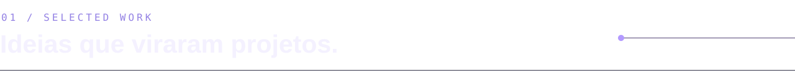
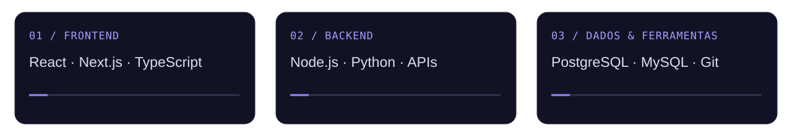

Sou **Tarcísio Lucas**, desenvolvedor full stack e estudante do **7º período de Engenharia de Software na UEPA**. Construo interfaces web, APIs e soluções de gestão. Meus projetos passam por colaboração com **Norium & Nora**, negócios com **Elares** e experiências digitais para turismo, serviços e entretenimento.

<a href="https://github.com/T-Lucas43/Norium-nora">Norium & Nora ↗</a> &nbsp; / &nbsp; <a href="https://github.com/T-Lucas43/norium-site">Site institucional ↗</a> &nbsp; / &nbsp; <a href="https://github.com/T-Lucas43/norium-whatsapp-api">WhatsApp API ↗</a>

<a href="https://github.com/T-Lucas43/elares-beauty">Elares Beauty ↗</a> &nbsp; / &nbsp; <a href="https://github.com/T-Lucas43/barbearia-gestao">Elares Barber ↗</a> &nbsp; / &nbsp; <a href="https://elares-el-assistant.shardweb.app/">Site da Elares ↗</a>

<a href="https://github.com/T-Lucas43/voya-turismo">Voya Turismo ↗</a> &nbsp; / &nbsp; <a href="https://github.com/T-Lucas43/dhages-turismo">D’Hages Turismo ↗</a> &nbsp; / &nbsp; <a href="https://github.com/T-Lucas43/rushLan">Rush LAN ↗</a> &nbsp; / &nbsp; <a href="https://github.com/T-Lucas43/Zona_7">Zona 7 ↗</a> &nbsp; / &nbsp; <a href="https://github.com/T-Lucas43/Site_Camilly">Camilly Oliveira ↗</a>

<strong>Mais projetos & trajetória</strong>

- [Desafio Compass — fundamentos de HTML, CSS e JavaScript](https://github.com/T-Lucas43/AWS_FS_JUL25_D01_COMPASS_-Desafio_01.-)
- [Edital UEPA](https://github.com/T-Lucas43/Edital-UEPA)
- [My Website · Catering](https://github.com/T-Lucas43/mywebsite)
- [Portfólio](https://github.com/T-Lucas43/portifolio)
- [Primeiro repositório](https://github.com/T-Lucas43/primeiro-repo)
- [Cyber Front · estrutura inicial](https://github.com/T-Lucas43/cyber-web-front)

 

