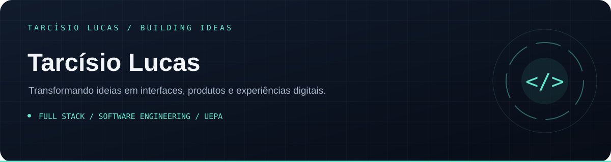
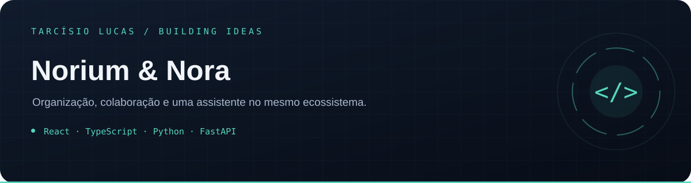
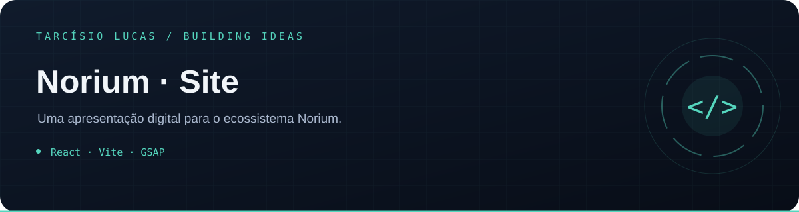
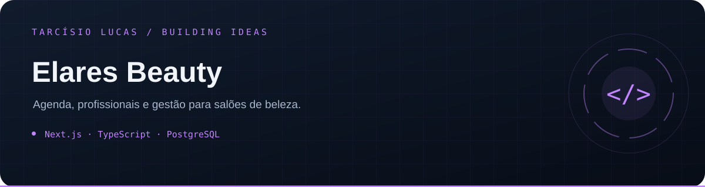
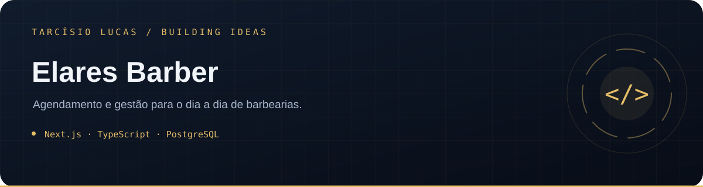
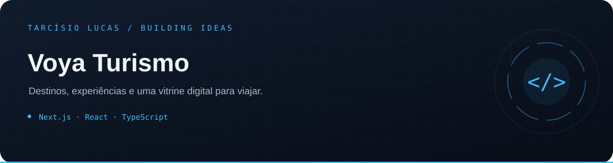
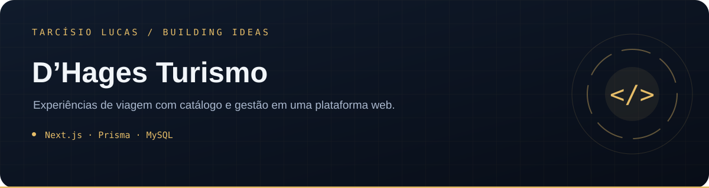

### Olá, eu sou o Tarcísio 👋

Sou desenvolvedor full stack e estudante do **7º período de Engenharia de Software na Universidade do Estado do Pará (UEPA)**. Trabalho com interfaces web, APIs e produtos digitais, conectando experiência de uso, organização e gestão.

Entre os meus projetos estão o ecossistema **Norium & Nora**, as soluções de gestão **Elares** e sites para turismo, serviços e experiências interativas. Este perfil reúne produtos, experimentos e minha evolução no desenvolvimento de software.

### Tecnologias que uso

### Projetos em destaque

<table>
<tr>
<td width="50%" valign="top"> Organização, colaboração e uma assistente no mesmo ecossistema. React · TypeScript · Python · FastAPI</td>
<td width="50%" valign="top"> Uma apresentação digital para o ecossistema Norium. React · Vite · GSAP</td>
</tr>
<tr>
<td width="50%" valign="top"> Agenda, profissionais e gestão para salões de beleza. Next.js · TypeScript · PostgreSQL</td>
<td width="50%" valign="top"> Agendamento e gestão para o dia a dia de barbearias. Next.js · TypeScript · PostgreSQL</td>
</tr>
<tr>
<td width="50%" valign="top"> Destinos, experiências e uma vitrine digital para viajar. Next.js · React · TypeScript</td>
<td width="50%" valign="top"> Experiências de viagem com catálogo e gestão em uma plataforma web. Next.js · Prisma · MySQL</td>
</tr>
</table>

### Explore meu trabalho

| Área | Repositórios |
| --- | --- |
| Web & experiências | [Camilly Oliveira](https://github.com/T-Lucas43/Site_Camilly) · [Rush LAN](https://github.com/T-Lucas43/rushLan) · [Zona 7 · Terminal](https://github.com/T-Lucas43/Zona_7) |
| E-commerce | Cyber Frontend (fork privado) · [Cyber · Front](https://github.com/T-Lucas43/cyber-web-front) · Cyber Backend (privado; revisão de credenciais) |
| Integrações | [Norium · WhatsApp API](https://github.com/T-Lucas43/norium-whatsapp-api) |
| Fundamentos & trajetória | [Compass · Desafio 01](https://github.com/T-Lucas43/AWS_FS_JUL25_D01_COMPASS_-Desafio_01.-) · [My Website](https://github.com/T-Lucas43/mywebsite) · [Primeiro Repo](https://github.com/T-Lucas43/primeiro-repo) · [Portfólio](https://github.com/T-Lucas43/portifolio) · [Edital UEPA](https://github.com/T-Lucas43/Edital-UEPA) |

Os repositórios documentam o escopo e os requisitos de cada projeto. Integrações e ambientes publicados podem exigir configuração própria.

---

<strong>Vamos conversar sobre tecnologia e construir boas ideias.</strong> <a href="https://www.linkedin.com/in/tarcisio-lucas-io">LinkedIn</a> · <a href="https://www.instagram.com/t__lucas.ai/">Instagram</a> · <a href="https://elares-el-assistant.shardweb.app/">Elares</a>

